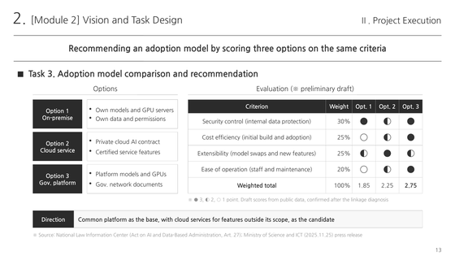

# biz-docgen-agent-skills

Agent Skills that generate HWPX, DOCX and PPTX document files. Every skill ships as a Korean original and an English translation.

HWPX, DOCX, PPTX 문서 파일을 직접 생성하는 에이전트 스킬 모음입니다. 모든 스킬은 한국어 원본과 영어 번역본을 함께 제공합니다.

<table>
  <tr>
    <td align="center" width="33%">
      <a href="skills/blockwriter/demo/en/"></a>
      <br><sub><a href="skills/blockwriter/">blockwriter</a></sub>
    </td>
    <td align="center" width="33%">
      <a href="skills/ieum-deck/demo/en/"></a>
      <br><sub><a href="skills/ieum-deck/">ieum-deck</a></sub>
    </td>
    <td align="center" width="33%">
      <a href="skills/juja-builder/demo/ko/"></a>
      <br><sub><a href="skills/juja-builder/">juja-builder</a></sub>
    </td>
  </tr>
</table>

<details>
<summary><b>English</b></summary>

## Skills

- [`blockwriter`](skills/blockwriter/): Converts a Markdown manuscript into an HWPX (Hangul) or DOCX report and reviews the pages by rendering. [Samples](skills/blockwriter/demo/en/)
- [`ieum-deck`](skills/ieum-deck/): Designs a planning or consulting deck as a storyboard.json and builds it as an editable PPTX file. [Samples](skills/ieum-deck/demo/en/)
- [`juja-builder`](skills/juja-builder/): Writes proposals, pre-diagnosis reports and planning reports for research and policy service contracts, from the RFP to HWPX and DOCX files. [Samples](skills/juja-builder/demo/en/)

## Installation

Each skill folder holds the install packages, a checksum file, the source folders and sample pages.

```
skills/juja-builder/
├── juja-builder-ko.skill    Korean install package
├── juja-builder-en.skill    English install package
├── SHA256SUMS.txt           SHA-256 checksums of the packages
├── ko/juja-builder/         Korean source
├── en/juja-builder/         English source
└── demo/                    sample pages
```

- A `.skill` file is a zip archive of the skill folder. Where only `.zip` uploads are accepted, rename the extension to `.zip`.
- To install from source, copy the folder named after the skill (for example `ko/juja-builder/`) into your agent's skills folder.
- The Korean and English editions share one skill name, so only one of them can be installed at a time.
- On claude.ai, the skills cannot install their dependencies at run time when GitHub access is blocked or the organization account does not allow network access in the code execution container. In that case, use [`offline-deps-builder`](https://github.com/emdashsmoker/biz-agent-skills/tree/main/skills/offline-deps-builder) in an environment with network access to build a dependency skill that holds the required files. Then load the dependency skill together with the original skill.

## Updates

Changes are recorded in [CHANGELOG.md](CHANGELOG.md).

## Limitations

- Testing used Claude Opus 5.5 and Claude Fable 5.1. Results may differ with other models and environments.
- Testing did not cover every edge case, and some skills have had limited testing.
- Some skills may duplicate functions of other skills.
- The skills work through whole RFPs and manuscripts over many steps, so token use is high.
- The skills need a code execution environment, Python packages and a page review renderer (rhwp or LibreOffice). `ieum-deck` also uses Node.js.
- The page review renderers approximate the layout, so the review images may differ from the final layout in Hancom Office or Microsoft Word.
- Laws, public programs and methods in the skills reflect the time of writing.
- The English editions also produce documents that follow Korean public-sector conventions.

## Disclaimer

The skills come as they are, without any warranty. Correct operation in every environment is not guaranteed. The end user bears responsibility for using the skills and their output. The organizations in the demo pages are fictional.

The HWPX writers were developed with reference to Hancom's published HWP document file (.hwp) specification. Hangul, Hancom Office and HWPX are trademarks of Hancom Inc. The skills in this repository have no affiliation with Hancom Inc.

## License

[AGPL-3.0-or-later](LICENSE). Copyright (C) 2026 Em Dash Smoker.

Each skill carries its own `LICENSE` and `NOTICE.md`. Under the output exception in `NOTICE.md`, the proposals, reports and decks you make with a skill are free of AGPL terms. Packages, fonts and programs that a skill installs at run time keep their own licenses, listed in the skill's `NOTICE.md`. The sample pages in the `demo/` folders are licensed under [CC BY-NC 4.0](https://creativecommons.org/licenses/by-nc/4.0/).

</details>

<details>
<summary><b>한국어</b></summary>

## 스킬 목록

- [`blockwriter`](skills/blockwriter/): 마크다운 원고를 HWPX(한/글) 또는 DOCX 보고서로 변환하고 렌더링으로 검수합니다. [예시](skills/blockwriter/demo/ko/)
- [`ieum-deck`](skills/ieum-deck/): 기획과 컨설팅 발표자료를 storyboard.json으로 설계해 편집 가능한 PPTX 파일로 만듭니다. [예시](skills/ieum-deck/demo/ko/)
- [`juja-builder`](skills/juja-builder/): 연구용역과 정책연구용역의 제안서, 사전진단보고서, 기획보고서를 RFP 입력부터 HWPX, DOCX 납품본까지 작성합니다. [예시](skills/juja-builder/demo/ko/)

## 설치

각 스킬 폴더는 설치용 패키지, 체크섬 파일, 소스 폴더, 예시 페이지 이미지로 구성됩니다.

```
skills/juja-builder/
├── juja-builder-ko.skill    한국어판 설치용 패키지
├── juja-builder-en.skill    영어판 설치용 패키지
├── SHA256SUMS.txt           설치용 패키지 SHA-256 체크섬
├── ko/juja-builder/         한국어판 소스
├── en/juja-builder/         영어판 소스
└── demo/                    예시 페이지 이미지
```

- `.skill` 파일은 스킬 폴더를 압축한 zip 파일입니다. `.zip` 파일만 업로드할 수 있는 환경에서는 확장자를 `.zip`으로 변경하여 업로드합니다.
- 소스로 설치하는 경우 스킬 이름과 같은 폴더(예를 들어 `ko/juja-builder/`)를 에이전트의 스킬 폴더에 복사합니다.
- 한국어판과 영어판은 스킬 이름이 동일하므로 한 가지만 설치할 수 있습니다.
- claude.ai에서 GitHub 접근이 차단되거나 조직 계정이 코드 실행 컨테이너의 네트워크 접근을 허용하지 않으면 스킬이 실행 중에 의존성을 설치할 수 없습니다. 이 경우 네트워크를 사용할 수 있는 환경에서 [`offline-deps-builder`](https://github.com/emdashsmoker/biz-agent-skills/tree/main/skills/offline-deps-builder)로 필요한 파일을 포함한 의존성 스킬을 사전에 생성합니다. 생성한 의존성 스킬은 원래 스킬과 함께 로드합니다.

## 업데이트

변경 내역은 [CHANGELOG.md](CHANGELOG.md)에 기록합니다.

## 한계

- 테스트는 Claude Opus 5.5와 Claude Fable 5.1에서 진행했습니다. 다른 모델과 실행 환경에서는 결과가 달라질 수 있습니다.
- 모든 예외 상황을 테스트하지는 못했습니다. 일부 스킬은 테스트가 충분하지 않습니다.
- 일부 스킬은 기능이 중복될 수 있습니다.
- 모든 스킬은 RFP와 원고 전체를 여러 단계에 걸쳐 처리하므로 토큰 사용량이 많습니다.
- 모든 스킬은 코드 실행 환경, 파이썬 패키지, 페이지 검수용 렌더러(rhwp 또는 LibreOffice)가 필요합니다. `ieum-deck`은 Node.js도 사용합니다.
- 페이지 검수용 렌더러는 배치를 근사하여 표현하므로 검수 이미지가 한컴오피스 또는 Microsoft Word의 최종 배치와 다를 수 있습니다.
- 스킬에 수록한 법령, 제도, 방법론은 작성 시점을 기준으로 합니다.
- 영어판도 한국 공공 문서 관행에 따라 문서를 작성합니다.

## 면책 고지

이 저장소의 스킬은 어떠한 보증 없이 있는 그대로 제공합니다. 모든 환경에서 정상 작동을 보장하지 않습니다. 스킬 사용과 결과물에 대한 책임은 최종 사용자에게 있습니다. 예시 페이지 이미지에 등장하는 기관은 모두 가상의 기관입니다.

본 제품은 한컴의 HWP 문서 파일(.hwp) 공개 문서를 참고하여 개발하였습니다. 한/글, 한컴오피스, HWPX는 한글과컴퓨터의 상표입니다. 이 저장소의 스킬은 한글과컴퓨터와 제휴 관계가 없습니다.

## 라이선스

[AGPL-3.0-or-later](LICENSE)를 따릅니다. Copyright (C) 2026 Em Dash Smoker.

각 스킬에는 `LICENSE`와 `NOTICE.md`가 포함되어 있습니다. `NOTICE.md`의 출력물 예외 조항에 따라 스킬로 만든 제안서, 보고서, 발표자료는 AGPL 조건 없이 사용할 수 있습니다. 스킬이 실행 중에 설치하는 패키지, 글꼴, 프로그램은 각각의 라이선스를 따릅니다. 해당 목록은 스킬의 `NOTICE.md`에 수록되어 있습니다. `demo/` 폴더의 예시 페이지 이미지는 [CC BY-NC 4.0](https://creativecommons.org/licenses/by-nc/4.0/deed.ko)을 따릅니다.

</details>

## References

Thanks to the developers and contributors of these projects.

이 프로젝트들의 개발자와 기여자분들께 감사드립니다.

- [rhwp](https://github.com/edwardkim/rhwp)
- [python-hwpx](https://github.com/airmang/python-hwpx)
- [python-docx](https://github.com/python-openxml/python-docx)
- [python-pptx](https://github.com/scanny/python-pptx)
- [PptxGenJS](https://github.com/gitbrent/PptxGenJS)
- [LibreOffice](https://www.libreoffice.org/)
- [H2Orestart](https://github.com/ebandal/H2Orestart)
- [Poppler](https://poppler.freedesktop.org/)
- [Nanum fonts](https://hangeul.naver.com/font)
